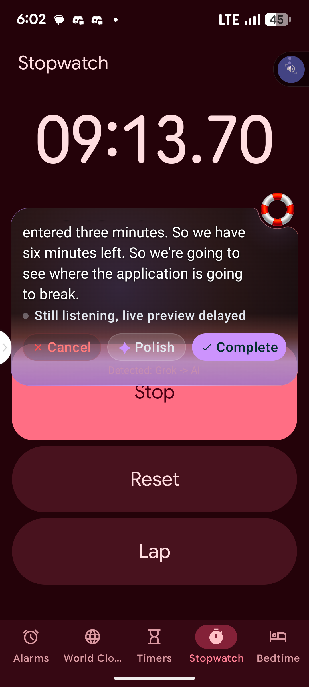

# Rapcha

Floating voice typing over every app. Kotlin and Gemini Live.

**[↓ Download latest APK](https://github.com/princeniithompson/Vs/releases/latest)**  
Releases will hold the newest APK.

## What it does

- A floating Lifesaver bubble sits over other apps.
- Live transcription as you speak.
- AI Polish before you send.
- Custom vocabulary for names and handles.
- Smart Safe Mode hides the bubble on banking and password screens.
- App-aware typing for the app you are using.

## Built with

Kotlin, Jetpack Compose, Android Accessibility, and Gemini Live.

## Privacy

Rapcha uses Accessibility and a screen overlay so the bubble can float and type into the app in front of you. Audio is used for transcription. Smart Safe Mode hides the bubble on banking apps and password screens.

## Status

Rapcha is in active development. It is not on the Play Store yet.

## License

TBD.
